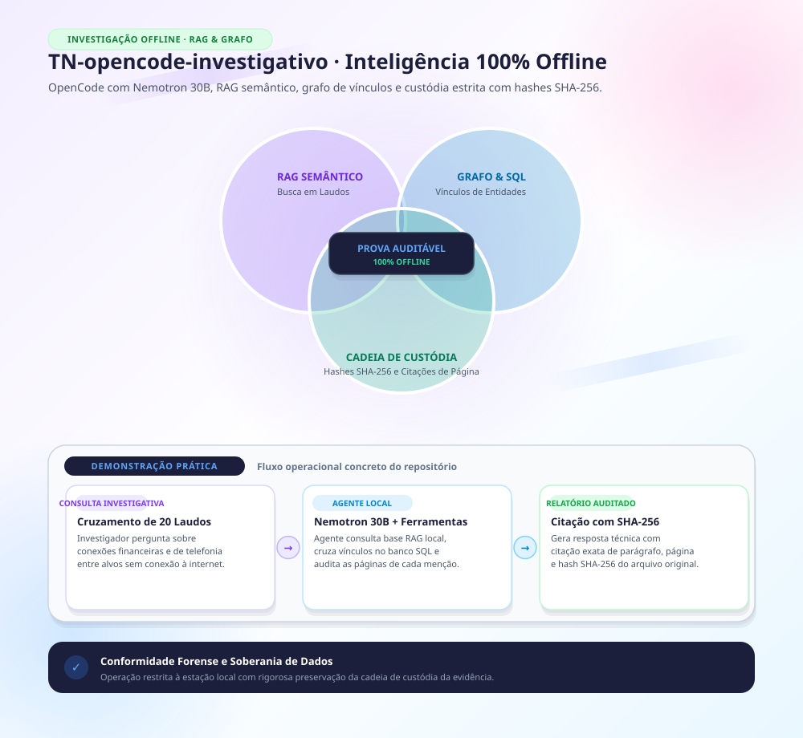

Feito por cópia de repo privado opencode-investigativo na versão c43f824 de TN em 11/2026.

---

# Agente investigativo local — OpenCode + Ollama

Configuração versionada do fluxo de investigação que roda **100% local**: LLM, embeddings,
índice, banco e grafo, tudo na própria máquina. Nada de acervo sai para a rede.

Documentação de uso em [GUIA.md](GUIA.md). Doutrina que os agentes seguem em
[AGENTS.md](AGENTS.md).

---

## Instalar numa máquina nova

```bash
git clone <url-do-repo> ~/.config/opencode
cd ~/.config/opencode
python3 instalar.py
```

O instalador detecta a máquina e gera o `opencode.json` local: caminho dos servidores MCP,
modelo padrão adequado ao hardware, e onde está a biblioteca forense. Confira antes com
`python3 instalar.py --conferir`, que diagnostica sem escrever nada.

> ⚠️ Se o Claude Code ou o OpenCode já rodaram na máquina, `~/.config/opencode` não está
> vazia e o `git clone` falha. Nesse caso:
> ```bash
> cd ~/.config/opencode
> git init && git remote add origin <url> && git fetch && git reset --hard origin/main
> ```
> A allowlist do `.gitignore` preserva o que é local (bancos de caso, `opencode.json`,
> `node_modules`).

### Pré-requisitos

| | Windows | macOS |
|---|---|---|
| Node/npm | Chocolatey | Homebrew |
| OpenCode | `npm i -g opencode-ai` | idem |
| `uv` | roda os servidores MCP | idem |
| Ollama | app | LaunchAgent (**não** `brew services`) |

⚠️ **O npm 11 bloqueia o postinstall** e o `opencode` "instala" sem baixar o binário, sem
erro chamativo. Se o comando não existir depois do install:

```bash
cd "$(npm root -g)/opencode-ai" && node ./postinstall.mjs
```

Modelos necessários:

```bash
ollama pull qwen3:8b && ollama pull qwen2.5-coder:7b && ollama pull nomic-embed-text
```

`qwen3-coder:30b` só vale a pena onde couber na GPU — veja abaixo.

---

## Por que existe um instalador em vez de um `opencode.json` versionado

O `opencode.json` guarda **caminho absoluto** no comando dos servidores MCP. Versioná-lo
faria a máquina macOS procurar `C:~/...` e falhar — a mesma classe de erro já
registrada na vault sobre os manifestos de plugin do Claude Code, que quebraram exatamente
assim ao serem restaurados entre sistemas operacionais.

Aqui o **template é a fonte da verdade do repositório** e o `opencode.json` é artefato
local, ignorado pelo git — o instalador o gera, guardando o anterior como
`opencode.json.anterior`.

### Mudou a configuração? Sincronize o template

Quem se edita no dia a dia é o `opencode.json` — é ele que roda. O template é o que a outra
máquina recebe. Sem sincronizar, a mudança fica só aqui e **nada avisa**:

```bash
python3 sincronizar_template.py --conferir   # aponta as chaves divergentes
python3 sincronizar_template.py              # deriva o template do config
```

Depois, commitar o template. Essa é a deriva silenciosa que o desenho template+instalador
introduz; o script é o antídoto.

O campo `instructions` é a exceção: aceita caminho **relativo ao diretório do config**, então
`AGENTS.md` funciona nas duas máquinas sem substituição (verificado em 24/08/2026).

---

## O modelo padrão muda com a máquina — e isso é medido

| Máquina | Modelo | Motivo |
|---|---|---|
| Windows, 8 GB de VRAM | `qwen3:8b` | o 30b roda **71% em CPU**: ~56 s por resposta trivial |
| MacBook M5, 48 GB unificados | `qwen3-coder:30b` | roda 100% em GPU |

O instalador escolhe sozinho (VRAM via `nvidia-smi`; memória unificada via `sysctl` no Apple
Silicon). Para forçar:

```bash
python3 instalar.py --modelo qwen3-coder:30b
```

Confirme depois com `ollama ps` — a coluna PROCESSOR diz a verdade sobre onde o modelo está
rodando. "Maior é melhor" não sobrevive ao contato com a VRAM.

---

## Biblioteca forense (opcional, mas recomendada)

Se `C:\ACERVO\Ferramentas` (ou `~/ACERVO/Ferramentas`) existir, o agente **importa** os
validadores de lá em vez de usar os próprios — evita que agente e pipeline divirjam na borda
e produzam achados que não se reproduzem. Também ganha as pontes `validar_lote`,
`resumo_alvo`, `indexar_acervo` e `geocodificar`.

Sem ela, o agente cai no fallback local, que confere DV de CPF/CNPJ e Luhn de IMEI, mas
**não** cobre nono dígito, CGNAT nem mojibake. Verifique a qualquer momento com a ferramenta
`forense_biblioteca_status`.

---

## O que este repositório NÃO contém

`rag/store/` — os bancos por caso, com texto integral dos documentos, entidades e
proveniência. É material sigiloso e fica **só** na máquina onde a investigação corre.

O `.gitignore` é uma **allowlist**: ignora tudo e libera item por item, para que arquivo novo
não entre por padrão. Não afrouxe.

O único dado de exemplo versionado é `rag/demo/`, integralmente fictício — faixas de IP da
RFC 5737 (TEST-NET-2/3), domínio `example.org` e documentos com dígito verificador calculado
sobre bases inventadas.

---

## Conferir se ficou de pé

```bash
opencode run --agent investigador "rode forense_biblioteca_status e resuma em uma linha"
```

E o caso de demonstração:

```bash
opencode run --agent investigador "No caso 'demo': quais contas convergem no mesmo IP?"
```

No Mac, o caso `demo` precisa ser reingerido (o banco não vem no repositório):

```
Ingira ~/.config/opencode/rag/demo no caso 'demo', origem "FICTICIO-TESTE".
```
